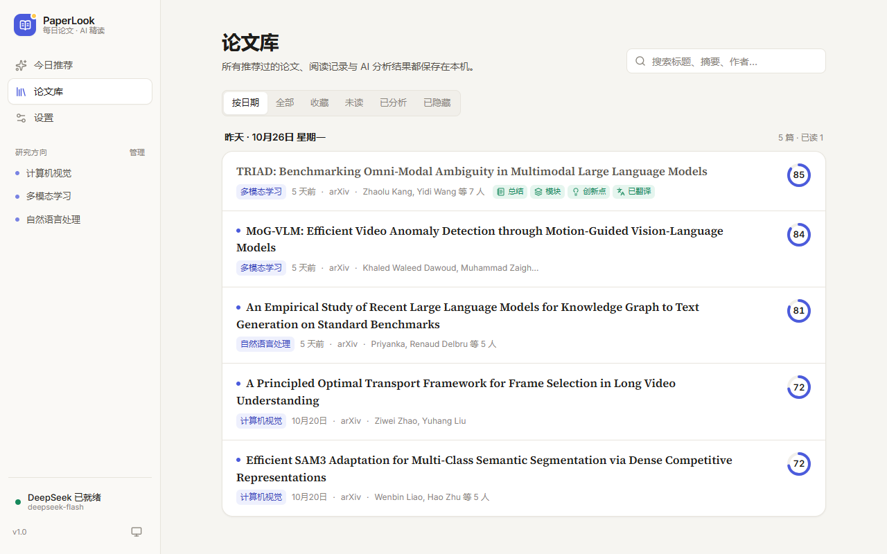
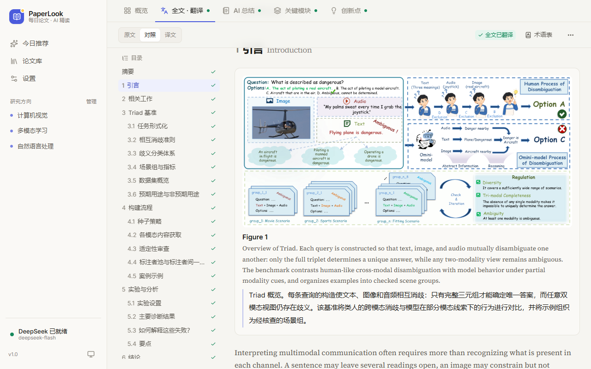
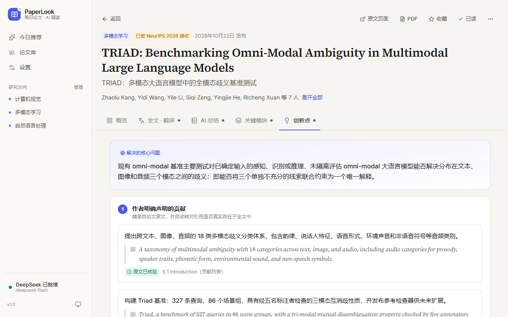
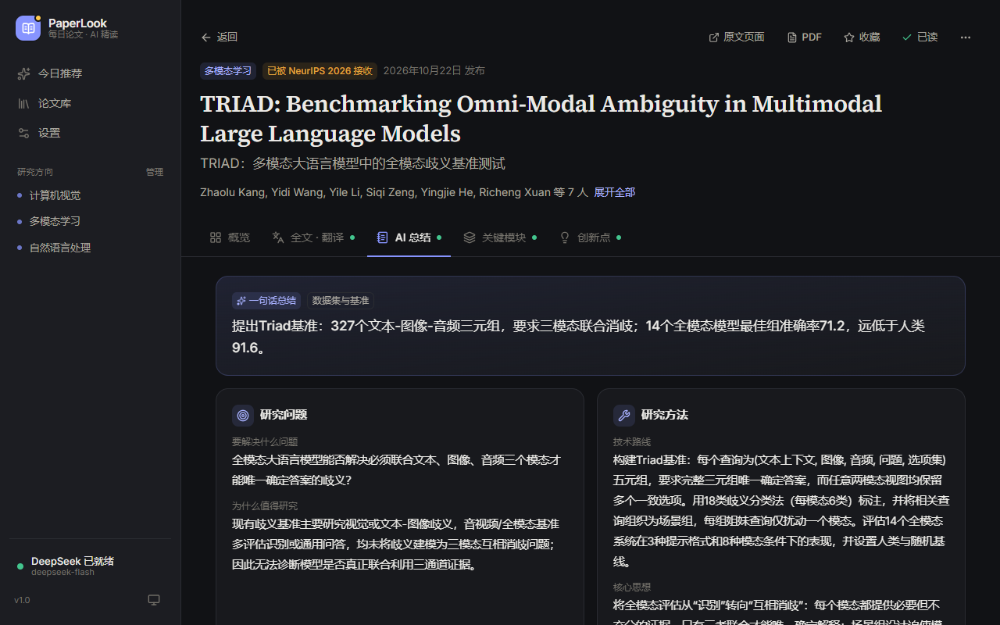

# PaperLook · 每日论文 · AI 精读

**每天打开、点一下按钮，就能拿到几篇与你研究方向相关、值得读的新论文；需要时再一键全文翻译、生成总结、分析关键模块、提取创新点。**

PaperLook 是一个运行在你自己电脑上的个人科研阅读工具（Windows 桌面应用，也可以从源码运行）。论文数据只来自固定的可信学术数据库；所有 AI 功能都只在你点击按钮时才会调用 AI（DeepSeek，或有免费额度的 Google Gemini），不会在后台偷偷消耗额度。

[](https://github.com/koara666/paperlook/actions/workflows/ci.yml) · [下载最新版本](https://github.com/koara666/paperlook/releases/latest) · [更新日志](CHANGELOG.md)

| 每日推荐（可解释评分） | 全文中英对照（公式保留） |
| --- | --- |
|  |  |
| **创新点提取（原文引用自动核验）** | **AI 总结（深色模式）** |
|  |  |

---

## 主要功能

| 功能 | 说明 |
| --- | --- |
| 每日推荐 | 从 arXiv、OpenAlex（可选 Semantic Scholar、PubMed）检索指定时间范围内**首次发布**的论文，自动去重，按「研究相关度 + 论文质量 + 时效性」综合评分挑选；推荐过的论文不会重复推荐 |
| 研究方向 | 用自己的话命名方向 + 几个英文关键词即可（提供 9 个预设，可让 AI 推荐关键词）；支持排除词、arXiv 分类、关注程度 |
| 可解释的排序 | 每篇论文都能看到评分构成、命中的关键词和质量依据（如「作者注明：已被 NeurIPS 2026 接收」「提供开源代码」），没有可靠依据时不会凭空打分 |
| 全文阅读 | 优先使用 arXiv 的结构化 HTML 全文（保留章节、公式、图片、表格、算法、参考文献），没有时自动解析 PDF |
| 全文翻译 | 按章节分块并发翻译；公式用占位符保护不被改动；自动生成术语表保证译名一致；原文 / 中英对照 / 译文三种视图；可单独重译某一节；中断后可继续；导出 Markdown |
| 论文总结 | 研究问题、方法、数据集与指标、主要结果、实验是否充分、局限性（区分作者承认 / AI 评估）、阅读建议 |
| 关键模块分析 | 整体架构、各模块职责/输入输出/原理/关键公式、模块协作流程；不含模块的论文（综述、理论等）会如实说明 |
| 创新点提取 | 严格区分：作者原文声明（附原文引用并**自动核验是否真实存在**）/ 基于内容归纳 / AI 推断的潜在价值 |
| 论文库 | 按日期查看推荐历史，收藏、已读、已分析、已隐藏筛选，全文搜索 |
| 成本可控 | AI 功能必须点击才运行；结果自动保存，重复打开不会重复请求；显示预计 tokens 与用量统计 |
| 两种 AI 服务 | DeepSeek（按量付费，很便宜，国内直连）或 Google Gemini（有每日免费额度，需要代理），设置里一键切换 |

---

## 安装（Windows，推荐）

1. 打开 [Releases 页面](https://github.com/koara666/paperlook/releases/latest)，下载 **`PaperLook-版本号-Windows-Setup.exe`**。
2. 双击安装（不需要管理员权限，也不需要安装 Python）。安装包没有数字签名，Windows 可能提示「Windows 已保护你的电脑」：点击 **「更多信息」→「仍要运行」**。
3. 从开始菜单或桌面图标打开 **PaperLook**，它会在自己的窗口里运行；关闭窗口即退出。

- 升级：下载新版本的安装包直接安装即可，数据会保留。也可以在「设置 → 数据与系统 → 关于」点「检查更新」。
- 不想安装：下载 `PaperLook-版本号-Windows-Portable.zip`，解压后双击 `PaperLook.exe`。
- 第一次打开可能需要十几秒（Windows 安全中心会扫描新程序），之后几秒内即可打开。
- 推荐与阅读不需要任何 Key；AI 翻译和分析需要 DeepSeek 或 Gemini 的 API Key（见下文）。

## 从源码运行（Windows / macOS / Linux）

**需要**：Python 3.11–3.14（PDF 解析组件 PyMuPDF 2.0 至少需要 3.11；最新的 3.15 暂时还缺少它依赖的 onnxruntime 安装包）、能联网。电脑上装了多个版本时，启动脚本会自动选择 3.14 → 3.11 中最新的一个。

1. **下载**：在 GitHub 页面点绿色的 **Code → Download ZIP**，解压到任意文件夹（路径里有中文或空格也没关系）。熟悉 git 的话也可以 `git clone https://github.com/koara666/paperlook.git`。
2. **安装 Python**（如果还没有）：<https://www.python.org/downloads/>，安装时勾选 **“Add python.exe to PATH”**。没装 Python 时双击 `start.bat` 也会提示并打开下载页面。
3. **双击 `start.bat`**。
   - 第一次启动会自动创建运行环境并安装组件（约 1–3 分钟）。默认源下载失败时会自动改用国内镜像（清华 / 阿里云）。
   - 之后每次启动只需几秒，浏览器会自动打开 <http://127.0.0.1:8765>。
4. （可选）**双击 `create_shortcut.bat`**，桌面上会出现 “PaperLook” 图标，以后双击图标即可启动。

> 运行期间会有一个最小化的命令行窗口，关闭它即可退出 PaperLook。重复双击启动不会开多个实例，只会再打开一次浏览器页面。
>
> 每个人的数据（推荐历史、翻译、AI 结果）都只保存在自己电脑上；API Key 保存在各自系统的凭据管理器中，不会出现在项目文件里。
>
> macOS / Linux：在项目目录运行 `./start.sh`（使用相同的启动逻辑；每次提交都会在 GitHub Actions 的 Linux / macOS 环境里自动启动测试一遍）。
>
> 源码版也可以用独立窗口代替浏览器：`pip install pywebview` 后运行 `python -m paperlook --window`。

---

## 第一次使用

1. 打开后在「今日推荐」页面勾选你关心的研究方向（例如 多模态学习、信息检索），点击 **「保存并获取今日推荐」**。
2. 约 10–30 秒后就能看到推荐列表。点击论文标题进入详情页。
3. 想用 AI 翻译和分析时，先配置 DeepSeek 或 Gemini（见下面两节，二选一即可）。**推荐与阅读本身不需要 API Key。**

## 选哪个 AI 服务？

| | DeepSeek | Google Gemini |
| --- | --- | --- |
| 费用 | 按量付费，很便宜（一篇论文全文翻译 + 三项分析约 0.5 元） | 免费 Key 每天有一定请求次数（见下文）；超出后第二天再用，或开通付费 |
| 网络 | 国内直接访问 | 中国大陆、香港无法使用，需要代理到美国、日本、新加坡等地区 |
| 速度 | 快（全文翻译约 20 秒） | 免费档自动限速，全文翻译约 1–3 分钟 |
| 隐私 | 付费 API | 免费档的请求内容可能被 Google 用于改进产品（论文是公开的，一般无妨） |

两个服务的 Key 可以都填，在「设置 → AI 服务」里随时切换；已生成的翻译和分析结果不受影响。

## 配置 DeepSeek API

1. 打开 <https://platform.deepseek.com/api_keys> 创建一个 API Key（以 `sk-` 开头），确保账户有余额。
2. 在 PaperLook 左下角点击「AI 功能未配置」，或进入 **设置 → AI 服务**。
3. 粘贴 Key，点击 **「保存并测试」**。测试会依次检查：身份验证 → 账户余额 → 模型调用，任何一步失败都会给出具体原因（Key 无效、余额不足、模型不可用、网络问题等）。
4. 模型默认 `deepseek-flash`（快、便宜，推荐）；需要更强推理可切换到 `deepseek-v4-pro`。「分析时启用深度思考」可让总结/模块/创新点更严谨，但更慢、更费 tokens。

**安全**：API Key 保存在 Windows 凭据管理器（系统加密存储）中，不写入项目文件、不进日志，网页里只显示打码后的形式，备份导出也不包含 Key。

## 配置 Google Gemini API（免费额度）

1. 开启代理（节点选美国、日本、新加坡、台湾等；香港不支持），用 Google 账号打开 <https://aistudio.google.com/apikey>，点「Create API key」，复制以 `AIza` 开头的 Key。
2. 在 PaperLook 的 **设置 → AI 服务** 选择 **Google Gemini**，粘贴 Key，点击 **「保存并测试」**。
3. 网络：代理软件开启「系统代理」即可；也可以在「代理地址」中填写代理软件的本地端口（如 Clash 的 `http://127.0.0.1:7890`、Clash Verge 的 `http://127.0.0.1:7897`）。
4. 模型推荐默认的 **`gemini-3.5-flash-lite`**：免费额度最多、速度快。`gemini-3.8-flash` 质量更好，但免费额度很少。

**免费额度够不够用？** 免费额度按**请求次数**计算，每个模型分开计数，每天北京时间 15:00（冬令时 16:00）重置。Google 现在不公布固定数值，以你在 [AI Studio 额度页面](https://aistudio.google.com/rate-limit) 看到的为准；2026 年 10 月的公开资料显示：Flash-Lite 约每分钟 10 次、每天 500 次，Flash 约每分钟 5 次、每天 20 次。PaperLook 在「免费档模式」下会合并翻译请求并自动限速：

| 操作 | 请求次数 |
| --- | --- |
| 全文翻译 | 约每 1500 词 1 次（1.3 万词的论文约 10 次，6 千词约 7 次） |
| 总结 / 关键模块 / 创新点 / 摘要翻译 | 各 1 次 |
| AI 精排、关键词建议、连接测试 | 各 1 次 |

按上面的额度：Flash-Lite 每天可以完整处理（翻译 + 三项分析）二三十篇论文，日常使用足够；Flash 每天只够翻译一两篇或分析几篇。当天额度用完时会明确提示，已完成的部分都会保存，第二天点「继续翻译」即可。「设置 → AI 服务」会显示今天已经用了多少次。

## 日常使用

- **获取推荐**：首页点击「获取今日推荐」。想多看几篇，点「再推荐几篇」（不会与已推荐的重复）。
- **快速调整**：首页上方的「时间 / 数量 / 方向」按钮可以直接改时间范围（1/3/7/14/30 天或自定义）、推荐篇数、参与推荐的方向。
- **看懂推荐理由**：点击论文右侧的评分圆环，可以看到相关度、质量、时效三项得分、命中关键词和质量依据。
- **读论文**：详情页的标签：概览 · 全文·翻译 · AI 总结 · 关键模块 · 创新点。打开「全文·翻译」会自动获取全文（免费，不调用 AI）。
- **AI 功能**：在对应标签页点击「全文翻译」「生成论文总结」等按钮才会运行。生成过程可以离开页面，完成后自动保存；需要时点「重新生成」。
- **整理**：星标收藏、标记已读、「不感兴趣」隐藏（可在论文库「已隐藏」中恢复）。

## 设置说明（设置页）

| 分类 | 可以做什么 |
| --- | --- |
| AI 服务 | 选择 DeepSeek / Gemini、API Key、连接测试、模型、深度思考、Gemini 免费档模式与代理、服务地址（高级）、用量统计 |
| 研究方向 | 添加/编辑/停用/删除方向，关键词、排除词、arXiv 分类、关注程度；AI 推荐关键词 |
| 推荐设置 | 推荐数量、时间范围、时间偏好、排序策略（均衡/相关性优先/质量优先/最新优先/自定义权重）、AI 精排（可选，消耗少量 tokens）、打开时自动获取 |
| 论文来源 | 启用/停用各数据库，填写可选的免费 API Key，查看上次获取情况 |
| AI 功能 | 各 AI 功能的开关（开启 ≠ 自动运行）、翻译是否保留英文术语、是否翻译附录、并发数 |
| 阅读与外观 | 浅色/深色/跟随系统、阅读字号、默认对照方式 |
| 数据与系统 | 导出/导入备份、清理缓存、清空推荐历史、数据目录与版本信息 |

## 数据保存在哪里

- 安装版：所有数据（论文、推荐历史、全文缓存、翻译、AI 结果、设置）保存在 `%LOCALAPPDATA%\PaperLook\paperlook.db`（SQLite），升级或卸载都不会删除。
- 源码版：保存在项目目录下的 `data/paperlook.db`。
- 备份：设置 → 数据与系统 → 导出备份（JSON，不含 API Key）。从源码版换到安装版：在旧版导出备份、在新版导入；API Key 在系统凭据管理器中，两个版本共用。
- 删除数据文件夹即可恢复到初始状态（API Key 仍在系统凭据管理器中，可在设置里删除）。

## 常见问题

**推荐结果很少或为空？** arXiv 周末不发布新论文；把时间范围改为 7 天，或为方向补充关键词。页面会提示具体原因（包括哪个来源请求失败）。

**Semantic Scholar 报 429？** 它对匿名访问限流严重，默认关闭；如需使用，请在「论文来源」中填写免费 API Key。OpenAlex 无 Key 时与同网络用户共享少量每日额度，经常使用建议也申请一个免费 Key。

**为什么有的论文没有全文？** PaperLook 只获取合法开放的全文（arXiv、开放获取 PDF），不会抓取需要订阅的出版商页面。此时可以使用「翻译摘要」，页面会明确标注这只是摘要翻译。

**PDF 来源的全文为什么公式显示不好？** PDF 无法还原 LaTeX，公式会以原样文本显示并标注、不翻译；arXiv HTML 来源没有这个问题。

**翻译中途关闭了怎么办？** 已翻译的段落都已保存，再次点击「继续翻译」只会翻译剩下的部分。

**一篇论文大概花多少钱？** 实测（2026 年 10 月，deepseek-flash，一篇约 1.3 万词的 arXiv 论文）：全文翻译约 7 万 tokens、耗时约 20 秒；总结 / 模块 / 创新点每项约 3 万 tokens、10–25 秒。全套运行（全文翻译 + 三项分析）约 **0.5 元**；同一篇论文的第二、三项分析会命中 DeepSeek 的上下文缓存，输入部分按缓存价（约 1/10）计费，所以更便宜。价格以 DeepSeek 官网为准，实际用量见「设置 → AI 服务 → 用量统计」，账户余额可在「测试连接」中查看。

**端口被占用？** 默认端口 8765，被占用时会自动使用下一个可用端口（启动窗口会显示实际地址）。

**Gemini 提示「地区不支持」或「无法连接」？** 中国大陆、香港不能直接使用 Gemini：开启代理软件的系统代理，或在「设置 → AI 服务 → 代理地址」填写本地代理端口，并把节点切换到美国、日本、新加坡等地区。

**Gemini 提示「今天的免费额度已用完」？** 等到北京时间 15:00（冬令时 16:00）额度重置后继续；或换用额度更多的 Flash-Lite 模型；或切换到 DeepSeek。

**安装版打不开 / 窗口空白？** 安装版使用 Windows 自带的 WebView2 组件显示界面（Windows 10/11 一般已经预装）。缺少时 PaperLook 会改为在浏览器中打开，也可以从 <https://developer.microsoft.com/microsoft-edge/webview2/> 安装。日志在 `%LOCALAPPDATA%\PaperLook\logs`。

---

## 技术概览

- 后端：Python（FastAPI + SQLite），负责检索、排序、全文解析、AI（DeepSeek / Gemini）调用和数据存储；只监听 `127.0.0.1`。
- 前端：React + TypeScript + Tailwind CSS（已构建好放在 `backend/paperlook/static/`，运行时不需要 Node.js）。
- 桌面应用：同一套代码用 PyInstaller 打包，界面显示在 pywebview（系统 WebView2）窗口中，Inno Setup 生成安装包。
- 版本号遵循 [语义化版本](https://semver.org/lang/zh-CN/)，变更见 [CHANGELOG.md](CHANGELOG.md)。GitHub Actions 在每次提交时于 Windows / Linux / macOS 上运行测试、检查前端构建产物、用启动脚本冒烟测试；推送 `v*` 标签时自动打包并发布 Release。
- 详细设计见 [ARCHITECTURE.md](ARCHITECTURE.md)；当前进度见 [PROJECT_STATUS.md](PROJECT_STATUS.md)；继续开发请先读 [AGENT_GUIDE.md](AGENT_GUIDE.md)。

### 开发者命令

```bash
# 后端测试
.venv/Scripts/python -m pytest backend/tests          # Windows
# 本地模拟 DeepSeek 与 Gemini（不消耗真实额度），在设置里把服务地址改为 http://127.0.0.1:8790
.venv/Scripts/python backend/tests/mock_deepseek.py
# 前端开发（热更新，接口代理到 8765）
cd frontend && npm install && npm run dev
# 修改前端后重新构建（输出到 backend/paperlook/static）
cd frontend && npm run build
# 打包 Windows 桌面应用（输出到 dist/；装了 Inno Setup 时同时生成安装包）
python -m pip install -r requirements-desktop.txt
powershell -File packaging/build_windows.ps1 -SmokeTest
```

发布新版本：修改 `backend/paperlook/__init__.py` 与 `frontend/package.json` 的版本号，在 `CHANGELOG.md` 写好该版本的内容，提交后推送标签 `git tag vX.Y.Z && git push origin vX.Y.Z`，GitHub Actions 会自动打包并发布。

## 许可证

[MIT](LICENSE) © 2026 koara666
